# Friends to Amigos

**1.6.0 · A complete Practice hub.** Learn new Spanish, strengthen skills in Practice, and retrieve it later in Review. Offline dictionary, standalone stories and the existing A1.1–B2.2 course remain.

An offline-first Android Spanish-learning app in a vanilla HTML/CSS/JavaScript WebView. European Spanish is the primary variety, including vosotros/as. No account, backend, runtime API, cloud grader or runtime npm dependency is required.

## App preview

Screens from the validated 1.5 UI, using simulated Samsung-size profiles and illustrative progress. Light and dark mode share the same five-tab navigation.

| Learn with support | Build and explore | Keep progressing |
| --- | --- | --- |
| 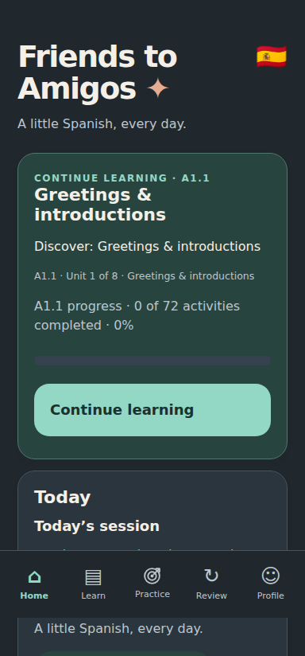<br>Continue Learning and Today | 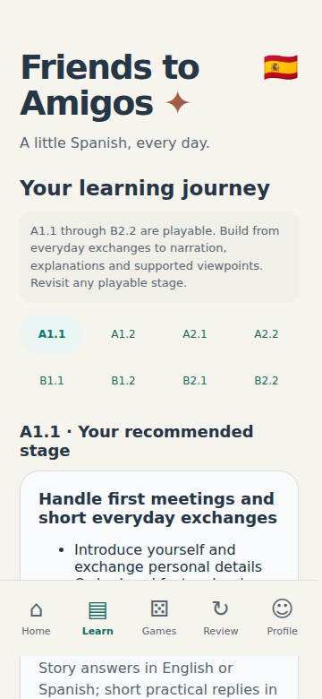<br>The course journey | 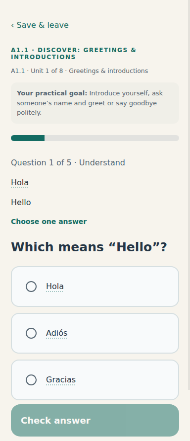<br>A supported first Spanish lesson |
| 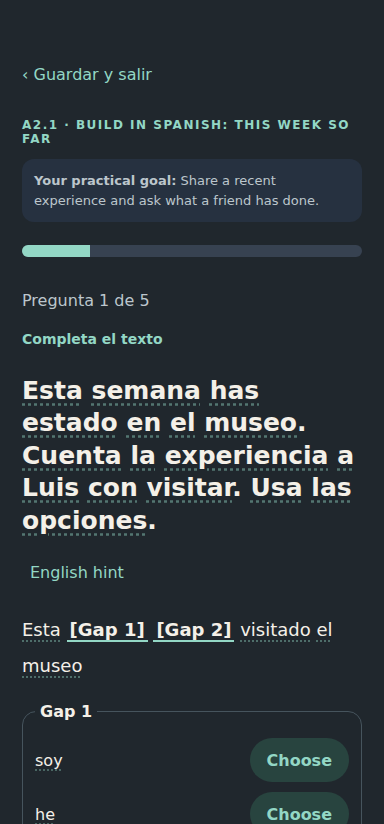<br>Contextual multi-gap Spanish | 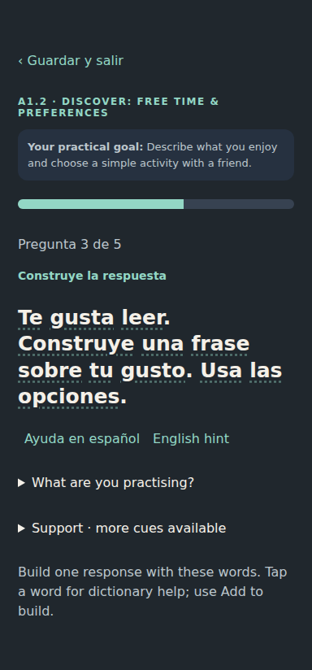<br>Build Spanish with supplied words | 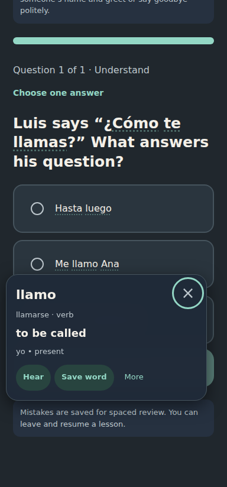<br>Vocabulary help before answering |
| 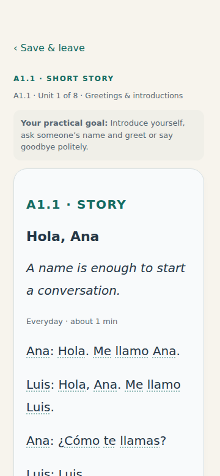<br>Standalone episodes with word help | 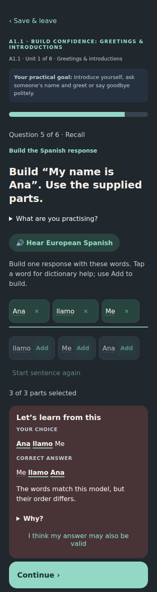<br>Compare your answer and learn why | 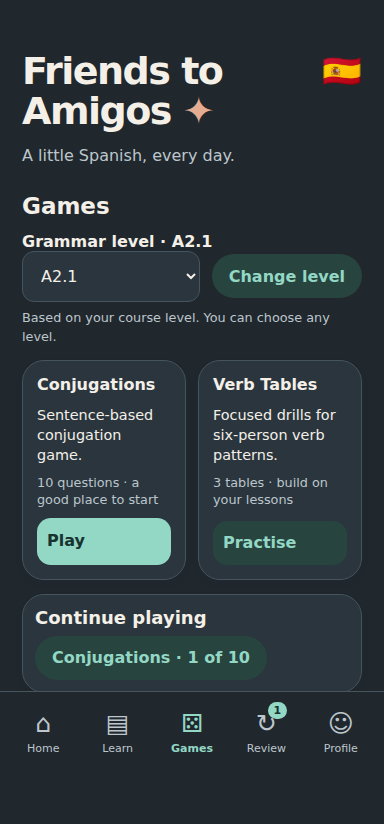<br>The Practice hub |
| 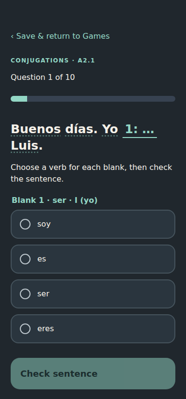<br>Verb in Context | 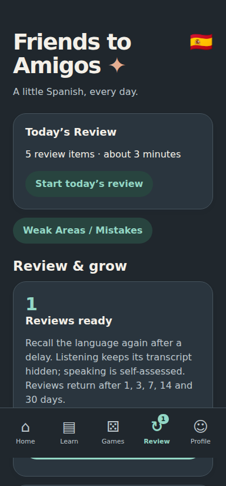<br>Scheduled review and weak areas | 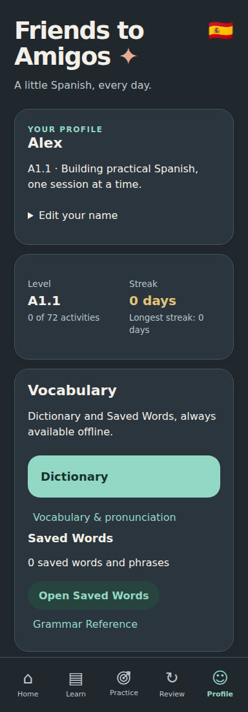<br>Level, progress and Vocabulary |
| 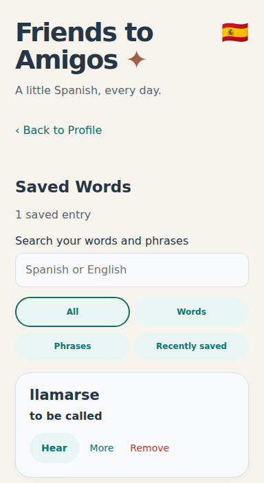<br>Your personal vocabulary | 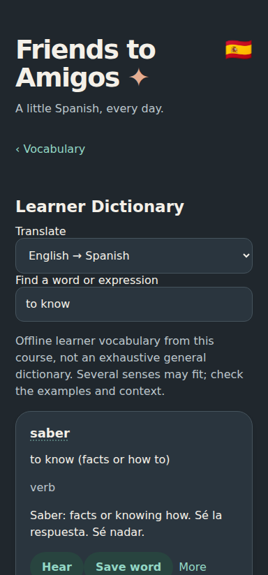<br>Search English or Spanish | 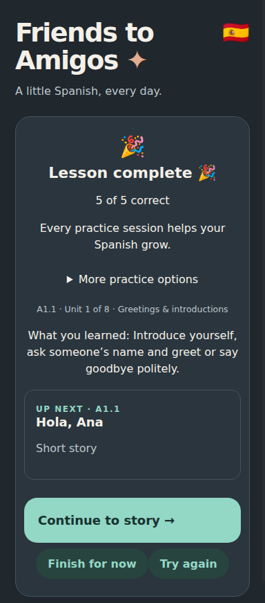<br>Continue straight to the next activity |

[Build results and device-testing limits](BUILD_STATUS.md) · [Release details](docs/release/V1_5_REPORT.md)

## Full course for user testing

**A1.1, A1.2, A2.1, A2.2, B1.1, B1.2, B2.1 and B2.2 are playable.** The course contains **576 activities, 3,328 question slots, 64 practical units and 256 original stories**. No C1/C2 stage is offered. This is a course milestone, not formal CEFR certification or independent proof of proficiency.

| Stage | Activities | Slots | Stories | Focused Listening / Speaking | Conjugations | Table targets |
| --- | ---: | ---: | ---: | ---: | ---: | ---: |
| A1.1 | 72 | 416 | 32 | 56 / 56 | 104 | 11 |
| A1.2 | 72 | 416 | 32 | 56 / 56 | 104 | 13 |
| A2.1 | 72 | 416 | 32 | 56 / 56 | 64 | 11 |
| A2.2 | 72 | 416 | 32 | 56 / 56 | 64 | 20 |
| B1.1 | 72 | 416 | 32 | 56 / 56 | 64 | 8 |
| B1.2 | 72 | 416 | 32 | 56 / 56 | 64 | 7 |
| B2.1 | 72 | 416 | 32 | 56 / 56 | 64 | 6 |
| B2.2 | 72 | 416 | 32 | 56 / 56 | 64 | 6 |

Each stage has eight units, three core lessons, four stories, a production activity and a checkpoint per unit. Recognition → controlled completion → recall → contextual response → transfer remains the learning progression. Activity/question IDs, ordering, practical unit goals and historical snapshots remain stable. The 1.5 story editions deliberately revise 24 passages and their comprehension tasks; the manifest records those changes, and old saved passages remain authoritative. Version 1.3 changed the interaction model. Version 1.4 retains those targets and adds two explicitly documented B1 glossary supports, with no new stage or story rewrite. See the [1.3 release report](docs/release/V1_3_REPORT.md), [assessment audit](docs/release/v13-assessment-audit.json) and historical [1.2 on-ramp report](docs/release/LEARNER_EXPERIENCE_REPORT.md).

B1 introduces connected narratives, practical advice, changes, viewpoints and limited wishes/necessity. B2 develops chronology, cause versus evidence, qualification, register, reported information, imagined conditions and integrated proposals. New material is original Friends to Amigos content; pedagogical references inform design without copied exercises.

## Stories and everyday Spanish

Ana, Luis and Marta are the three primary recurring characters in the [Story Bible](docs/STORY_BIBLE.md). All 256 existing story slots gain clearer reading presentation, episode metadata and hooks. Twenty-four carefully authored editions (three per stage) balance practical, social and comedy/chaos episodes, including the wrong wedding venue, a sofa reserved for a plant and a supposedly talking toaster. The remaining 232 original episodes are retained; this is a bounded editorial pass, not a claim that every story has been rewritten or evenly category-balanced.

Stories stand alone, use useful Spanish, and can include chat, notes, reviews, optional ungraded prediction and different perspectives. Controlled inference, sequence/viewpoint and supplied-message construction preserve five permanent question slots. [The story audit](docs/release/v15-story-audit.json) and [manual QA checklist](docs/release/V1_5_MANUAL_QA.md) describe coverage and limits. Independent educator/native-speaker review remains necessary.

## Vocabulary and private answer reports

Profile → Vocabulary offers **Dictionary** and **Saved Words**. Search English → Spanish or Spanish → English using the existing offline learner vocabulary, including known forms, multiple senses and region notes where available. “To know” distinguishes saber and conocer. Thirty common nouns receive curated gender/example notes. Hear, Save/Remove and More use the existing local dictionary tools. This is a bounded course learner dictionary, not every word in Spanish.

An optional approximately five-minute pronunciation primer covers key Spain-Spanish sounds with synthetic examples. It records nothing and does not grade pronunciation.

If an answer may also be valid, save a private editorial report without changing its score. Profile → Data & backup exports the reports, including your response, model and permanent identity, only when you choose. Nothing is uploaded; exported reports can contain your writing. See [release notes](docs/release/V1_5_RELEASE_NOTES.md).

## A connected learning loop

Learn → optional grammar reinforcement → understand mistakes → retrieve later → focus weak areas → maintain practical ability. Continue Learning stays primary; games and refreshers are optional.

- **Support changes, the target stays the same.** Relevant repeated errors restore a pattern guide or a smaller controlled step. Less support requires sustained independent, spaced evidence; selecting a level or succeeding once is insufficient.
- **Spanish help before English.** Appropriate Spanish-first tasks offer simpler Spanish guidance, then the existing English hint. Support changes evidence strength, never visible correctness. Dictionary lookup remains a vocabulary aid and never counts as a hint.
- **Today’s Review** mixes due snapshots, weak concepts, older success, recent completed material and confidence-building retrieval. Later levels interleave topics; first-stage review stays more focused. Optional Sure / Not sure captures uncertainty without penalising scores.
- **Grammar Reference** covers all 44 central syllabus concepts, with patterns, examples, common mistakes and level-controlled practice. Weak Areas can open a short refresher and 3–5 targeted questions, then continue practice. Completion and the evidence states Practising / Improving / Strong / Needs practice are separate.
- **Speaking → Shadowing** reuses existing eligible authored phrases. Hear, repeat aloud, reveal suggested chunks and self-assess. This is assisted imitation, with weaker evidence than recall. No microphone, recording, speech recognition or pronunciation scoring is involved.
- **Listening** remains audio-first. After an attempt, replay short phrases with a visible selected chunk. Synthetic Spanish (Spain) speech depends on the installed voice; there is no human-speaker or timed acoustic-alignment claim.

The regular -ER present pattern now joins -AR/-IR in A1.1 grammar practice, with explicit teaching support. The original comer target identity remains unchanged; A1.2 consolidates it. Practice follows the existing manually selected grammar level, while course/focused-media eligibility keeps its existing progression rules.

The [quality report](docs/release/V1_4_REPORT.md), [load audit](docs/release/v14-learning-load.json) and [current recommendation review](docs/release/V1_4_RECOMMENDATIONS.md) record the evidence and limitations. Recommendations load locally; external sites alone need internet. The developer recommendation audit checks dates, expiry, allowed providers and access metadata without requiring a live runtime request.

## Build first, then express yourself

**A textbox means expression. A specific language target uses a structured interaction.**

| Stage | Live assessment approach | Guided/free writing slots |
| --- | --- | ---: |
| A1.1 | Models, recognition, supported completion, word banks and sentence building | 0 |
| A1.2 | Sentence/phrase construction, dialogue completion and contextual cloze | 0 |
| A2.1 | Connected multi-gap passages and more demanding phrase construction | 0 |
| A2.2 | Structured practice alongside an intentional guided-writing bridge | 23 |
| Each B1/B2 stage | Structured reproduction alongside genuine connected expression | 80 |

**1,195 course text-slot representations** become controlled interactions; another 11 Numbers/Time and 133 newly generated focused-listening items use controlled responses. This includes 18 early guided-labelled tasks whose finite targets are better practised through construction. Word/phrase tiles, duplicate tokens, reset/remove, contextual one-to-multiple gaps, per-gap feedback and narrow safe alternative orderings support active production without an apparently unrestricted textbox. Factual story comprehension uses precise controlled choices. No checkpoint threshold or final-stage objective is lowered.

## Writing that can admit uncertainty

- **Controlled**: supplied banks, gaps and choices assess the named target. Historical typed-answer snapshots still use their original accepted variants. Case, punctuation, spacing, vowel accents and ü remain tolerant where applicable; ñ and negation remain meaningful. No substring grading.
- **Guided**: accepted formulations can be verified. Other natural formulations survive as uncertain/model comparison, rather than automatic incorrect answers. Task-coverage evidence is not proof of grammar.
- **Free**: independent connected responses receive conservative coaching, model comparison and reflection. Even an exact model match is not automatically essay-graded.

Twenty-three first-party, level/unit-aware rules explain taught errors. The curated verb adapter can diagnose wrong-person or explicitly requested wrong-tense forms, including Spain vosotros. Near-model spelling comparison is a limited diagnostic, not a dictionary or general grammar checker. Authored accepted variants and misconception feedback take precedence.

Open writing uses multiline fields (up to 6,000 characters), model pronunciation, **Why?**, revision before reflection, and “I compared / revised” or “Needs practice”. Enter creates a newline; short controlled inputs retain keyboard Go submission. Revising after seeing a model counts as assisted. Unverified reflections never count as verified accuracy or clear a scheduled review. A positive reflection may defer a due open item by one day without increasing verified successes. Negative evidence saves the response/model/context for later practice. The checkpoint threshold remains **80% of objective items**; all required reflections must still be completed. Completion is not certification of open-writing grammar.

See [writing resources and implementation decisions](docs/resources/WRITING_ENGINE.md), the [160-item A1–A2 writing audit](docs/release/a1-a2-writing-audit.json), and [release quality report](docs/release/V1_REPORT.md).

## Listening, speaking and daily retrieval

Focused Listening and Speaking each contain **448 items**, 56 per stage. Normal sessions select ten unique items, avoid a bounded recent 30-item history, target weaknesses and balance topics. Where sufficient material exists, six current-stage items recycle two from the preceding stage and one each from two earlier stages; at early stages the smaller previous-stage set receives the remainder. Insufficient inventories fill from eligible earlier material, never future material.

Focused media require taught core lessons. B narrative clips and retelling prompts additionally require their source story, so learners are not asked to recall an unknown scenario. Accepted placement assumes earlier foundations; current-stage material still requires teaching. Historical saved question/passage snapshots remain authoritative on resume.

Listening is audio-first: answers stay locked until actual recording/TTS start; failed recordings can fall back to TTS; failure offers skip-to-review. Transcripts appear after attempt/skip. Slow 0.75× and Normal 1× replay remain. Speech uses **synthetic Spanish (Spain)** and an installed local offline voice. No human-speaker datasets are bundled, and bridge tests do not validate acoustic quality.

Speaking is **self-assessed**. Say the response, reveal one possible model, optionally hear it, choose “I got it” / “Needs practice”. The app does not request a microphone, record, transcribe or assess pronunciation. Weak items/concepts return later, and same-session repetition cannot manufacture spaced mastery. First-use explanations become compact after successful use; accessible information remains available.

Today resumes unfinished work first, then guides due review, the next required lesson and short media retrieval. Today’s Review combines due SRS mistakes and eligible weak/older practice. Weak Areas translates evidence into useful labels and launches eligible targeted practice. Passed lessons preview the actual next required activity and Continue goes straight there, including stories, checkpoints, next units and stages. **Finish for now** returns Home. Today continuation takes precedence; failed lessons offer retry/mistake review without skipping ahead. Completed paths lead to review/maintenance rather than a fabricated next lesson.

## Practice hub and grammar levels

Practice contains **Verb in Context** (592 original sentence contexts, ten-question rounds) and **Verb Trainer** (82 curated verb/tense targets, normal three-table rounds). Custom practice inside these two engines retains an independent grammar-level ceiling; source activities document where material is taught. Course progress and weaknesses recommend content, while game success never completes lessons, checkpoints, stages or placement.

Verb in Context balances concepts/persons/verbs, shuffles questions/options, avoids recent items and weights weak evidence. Mistake and Challenge modes use only the selected grammar ceiling. Feedback evaluates each blank separately and teaches distractor-specific person/tense patterns. Homographic nouns/connectors are excluded from new B-bank matching, and ambiguous shared forms do not generate artificial person mastery.

Verb Trainer retains six Spain-first rows, varied blank positions, hints, typed recall, mastery-gated full blank tables and mistake practice. Practice supports 3/5/10/15/20 tables, Recommended/Current level/All up to current level and simple custom grammar filters. Curated targets avoid misleading constructions such as a generic doler/gustar paradigm. Taught B targets add future, conditional, subjunctive and compound forms; -ra and -se past-subjunctive alternatives retain the nosotros accent.

## A gentler first encounter with Spanish

The first Unit 0 teaching activity models useful chunks before easy recognition and supported completion. The second retains substantial support with easy sentence-bank recall near the end. The third builds contextual responses and a simple role transfer using supplied Spanish. Genuine unrestricted writing waits until the A2.2 bridge. The intervening stories remain available; no lesson is added, removed or reordered. Early feedback teaches useful meaning before grammatical labels. Productive construction, listening, self-assessed speaking, transfer, checkpoints and personalised Review remain part of A1.

Previously learned language should scaffold new language. A family introduction reuses **me llamo**; a later flat visit reuses **vivo en** before **hay** introduces rooms. The [A1 anchor recurrence report](docs/release/a1-anchor-recurrence.json) lists where fifteen useful constructions recur and flags long literal-form gaps for educator review. These are exposure observations, not mastery claims or rigid frequency targets.

## Explore Spanish and save vocabulary

Tap visible Spanish before answering, including a Spanish quotation inside an English prompt and Spanish answer-option text, to open a compact contextual dictionary. **Tap a Spanish word for vocabulary help; tap the answer card, radio or padding to select an answer.** These are separate controls. Surrounding English stays undecorated; ambiguous unmarked language is handled conservatively. A small early tip disappears after a successful lookup. Known expressions take priority; common verb forms link to their infinitive/person/tense. Hear uses the existing es-ES TTS; More offers a few useful senses/examples. Lookup and saving do not count as hints or affect course scores, review, mastery or progress. Hidden listening transcripts and unrevealed speaking models stay hidden.

The offline bank contains **954 word entries, 276 expressions and 1,564 known form mappings**, compiled from original course glossaries/phrase banks and curated first-party definitions. No commercial dictionary service or third-party corpus is used. **Saved Words is inside Profile**, with count, search, All/Words/Phrases/Recently saved, pronunciation, More and Remove. Word forms deduplicate to the base; useful constructions save as phrases. See [dictionary architecture and coverage limits](docs/LEARNER_DICTIONARY.md).

## A calmer Home and Profile

Home puts **Continue Learning** first, then **Today** and **Quick Practice**. Weak coaching and advanced tools use progressive disclosure. Today groups streak, reviews and learning time; Needs Attention includes shared course/game/table/media weaknesses. Profile groups your summary, level/streak, Vocabulary/Dictionary, progress, practical capabilities and recommendations. Name editing, placement and data controls are expandable. Detailed period statistics and the seven-day chart remain available; placement, export/import and reset sit below them.

**Content for Your Level** is a Profile secondary screen, not another tab. A local catalogue has 30 editorial entries / 29 distinct links. Each stage shows 15 recommendations: three Films/TV, Books, Audiobooks/narrated stories, Steam games and YouTube channels. Suitability ranges deliberately reuse resources. Comfortable/Stretch advice describes likely learner challenge, not certified CEFR levels. Each card includes access, subtitle/audio and variety caveats; external links open in a browser. The catalogue works offline; external content needs internet and may need payment/registration. See [current provider verification and availability limits](docs/release/V1_4_RECOMMENDATIONS.md).

Warm cream/pale blue-grey light surfaces and softer navy/charcoal dark cards retain the app identity. Teal/mint supports primary actions and active navigation, terracotta marks attention and gold supports streaks/milestones. Red is reserved for errors and destructive operations. Icons, text and borders accompany colour states.

## Mobile and learner data

Home / Learn / Practice / Review / Profile remain in that exact order, including Review. Saved Words stays inside Profile. Android Back closes an open dictionary first, then saves/leaves or navigates as before; Home backgrounds normally. Native WindowInsets remain the sole safe-area source. Fixed navigation, final controls, status-bar spacing, cutouts, keyboard overlap and toasts retain their protections. Input focus hides app navigation while the keyboard is open. Choice radios and sibling vocabulary text wrap on narrow phones, with separate keyboard/focus behaviour. The named Galaxy S22/S24/S25 browser profiles vary CSS viewport, insets, keyboard, text scaling and theme rather than physical resolution or device detection. Light and system dark themes and bull-face launcher assets are preserved; primary actions now use the calmer teal/mint palette.

Storage remains **schema v2** under `friends-to-amigos-v1`. The optional `savedWords` list defaults safely for old saves, deduplicates and exports/imports without changing historical attempts or review records. Optional `dictionaryTipSeen` accepts only `true` to remember successful discovery; it is a product preference, never a learning hint. Visible teaching/Spanish-fragment metadata is validated in saved question snapshots. V1 migration, recovery/read-only protection, malformed import rejection and historical snapshots remain. Optional question `writing`/`previousResponse` and active `writingResponses` fields default safely; no completion history is fabricated. Pending comparison, revised response and reflection resume/export/import. New structured snapshots contain bounded tile/gap data and partial selections; invalid imported selections are rejected before replacing valid progress. Historical typed attempts are never replaced by live adapted content. A structured success cannot clear an older typed Review snapshot; structurally different scaffolding also cannot clear it. A later starting path assumes foundations without awarding skipped completions; actual completion statistics remain accurate.

## Development and release validation

```sh
npm run check
npm test
npm run audit
npm run audit:learning
npm run audit:stories
npm run audit:recommendations
npm run check:browser
node scripts/learner-release-audit.cjs
```

```sh
gradle -p android assembleDebug lintDebug testDebugUnitTest
```

No new dependencies are needed. The established GitHub Actions workflow runs static, JS, rendered browser and Android build/lint/unit checks and uploads `friends-to-amigos-android` and reports. See [BUILD_STATUS.md](BUILD_STATUS.md) for exact performed results and limits, and the [user-testing checklist](docs/release/USER_TESTING.md) before wider distribution.

Preserve signing keys for in-place upgrades. A fresh CI debug key may differ from an installed APK: verify an exported backup before any uninstall. Local Chromium cannot launch in this restricted execution environment, so rendered browser and native validation use CI. Current recommendation availability was checked separately against public first-party information; paid/regional playback and stock remain unverified as documented. No physical-device, emulator, acoustic TTS or native-speaker validation is claimed for this release.

## Limits and next step

The tiny placement screen is provisional and cannot establish CEFR speaking/writing competence. Structured tasks assess supplied language and authored alternative orders, rather than arbitrary paraphrases; historical finite text matching can still reject unlisted alternatives. Open writing deliberately admits uncertainty. The curated morphology/rules do not implement arbitrary Spanish parsing, general spellchecking or authoritative essay grading. The learner dictionary is a separate bounded vocabulary explorer. Listening lacks human-speaker variation; speaking is self-assessed. All eight stages should now undergo real learner and Spanish educator review, especially B-level pacing, naturalness, task ambiguity and false acceptance/rejection. Freeze expansion for user testing rather than begin C1/C2.

## Short optional skill rounds

Practice groups Recommended for you, Games, Listen & Speak, Grammar Training, Vocabulary and Mistakes. Sentence Builder uses existing tap-to-order tiles; Spot the Mistake teaches explicit authored corrections; Numbers & Time mixes numbers/prices, dates, clocks and occasional audio-first items. Word Match uses paired recognition; Rapid Recall gives immediate feedback. New rounds contain ten unique items, rotate recent items, and weight real weaknesses. Fix My Mistakes is on-demand reinforcement; the Review tab remains scheduled retrieval. New activities use reached course language and encountered dictionary vocabulary. A small opening-unit greeting/name starter keeps early practice usable; variety grows with course progress.

Home now offers one Practice recommendation rather than a catalogue. Listening, self-assessed Speaking and assisted Shadowing remain distinct. Grammar Reference stays in Profile. Practice can update evidence and streak practice, but never completes a required lesson. See [implementation and limits](docs/release/V1_6_REPORT.md), [release notes](docs/release/V1_6_RELEASE_NOTES.md) and [QA checklist](docs/release/V1_6_MANUAL_QA.md).
